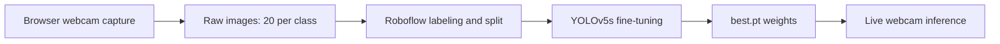

# Drowsiness Detection with YOLOv5

A small object-detection project that trains a custom YOLOv5s model to label webcam frames as `awake` or `drowsy`, built end to end in Google Colab.

## Problem Statement

Drowsiness reduces attention and reaction time, which matters for people who drive or operate equipment. This project explores whether a lightweight object detector, trained on a small self-collected dataset, can recognise a drowsy face in a webcam feed.

## Solution Overview

The notebook collects images from the browser webcam, labels them in Roboflow, and fine-tunes a pretrained YOLOv5s model on two classes. It then evaluates the model on a held-out validation split and runs it on a live webcam stream inside Colab. Colab has no physical camera, so frames are captured by JavaScript in the browser and passed to Python.

## Pipeline



1. **Capture:** A JavaScript helper opens the webcam and returns a 640x480 JPEG frame to Python on request.
2. **Label:** Images are annotated with bounding boxes in Roboflow and exported in YOLOv5 format.
3. **Train:** `train.py` fine-tunes pretrained `yolov5s.pt` on the exported dataset.
4. **Infer:** The best checkpoint is loaded with `torch.hub` and run on single images and on live frames.

## Dataset

| Item | Value |
|---|---|
| Source | Self-collected through the browser webcam in one session |
| Captured | 40 images (20 `awake`, 20 `drowsy`), one frame every 0.5 s |
| Labels | Bounding boxes, 2 classes: `awake`, `drowsy`, annotated in Roboflow |
| Train split | 28 images |
| Validation split | 8 images (8 labeled instances: 6 `awake`, 2 `drowsy`) |

The 28/8 split of 40 images is consistent with a 70/20/10 train/valid/test split in Roboflow. The notebook does not report a test split or evaluate on it, and the preprocessing and augmentation settings used in Roboflow are not recorded. The one validation image used for the spot check was 512x512, so the export was probably resized.

## Methodology

1. **Sanity check.** Pretrained COCO YOLOv5m is run on a sample image, and COCO YOLOv5s on the live webcam, to confirm the Colab setup and the browser webcam loop work before any training.
2. **Training command:**
   ```
   python train.py --img 320 --batch 8 --epochs 300 --data /content/dataset.yml \
     --weights yolov5s.pt --workers 2 --cache --freeze 10 --patience 100
   ```
   - Starting from pretrained `yolov5s.pt` and freezing the first 10 layers (the backbone) keeps the pretrained features fixed. This limits overfitting on a 28-image training set.
   - A small batch size gives more weight updates per epoch on a tiny dataset.
   - A 320 px image size keeps training fast. All 300 epochs completed in about 4.4 minutes (0.073 h) on a Tesla T4, so early stopping (`--patience 100`) never triggered.
   - Augmentation comes from YOLOv5's default `hyp.scratch-low` settings (mosaic, HSV jitter, horizontal flip). The optimizer is SGD with `lr0=0.01`.
3. **Evaluation.** YOLOv5's built-in validation on the 8 validation images reports precision, recall and mAP.
4. **Inference.** `best.pt` is loaded with `torch.hub.load(..., source='local')`. The confidence threshold is set to 0.4 for live use.

## Results

Validation set, `best.pt`:

| Class | Images | Instances | Precision | Recall | mAP@0.5 | mAP@0.5:0.95 |
|---|---|---|---|---|---|---|
| all | 8 | 8 | 0.724 | 1.000 | 0.900 | 0.657 |
| awake | 8 | 6 | 0.794 | 1.000 | 0.972 | 0.734 |
| drowsy | 8 | 2 | 0.654 | 1.000 | 0.828 | 0.580 |

- A recall of 1.0 means every labeled face in the validation images was found.
- A precision of 0.72 means roughly a quarter of the predicted boxes did not match a label, with `drowsy` the weaker class.
- A spot check on one validation image returned a single `drowsy` detection.
- Live webcam detection ran in Colab, but frame rate and accuracy were not measured in the notebook.

These numbers should be read as a smoke test, not as a performance claim. The `drowsy` class has only 2 validation instances, so a single error moves its scores a lot. The frames were captured 0.5 s apart, so near-identical frames probably ended up in both the train and validation splits, which would make the scores optimistic.

## Design Decisions and Trade-offs

- **Roboflow instead of labelImg:** labelImg is a desktop GUI and cannot run in Colab. Roboflow works in the browser and handles the train/valid split.
- **Browser webcam instead of `cv2.VideoCapture`:** The Colab server has no camera, so each frame travels through the browser. This works anywhere, but it limits frame rate compared with running locally.
- **Object detection for a state label:** Treating `awake` and `drowsy` as detection classes is simple to set up with YOLOv5. Alternatives such as an image classifier or eye-landmark methods are not explored in the notebook.

## Getting Started

**Prerequisites:** a Google account, a Colab runtime with a T4 GPU, a Roboflow account and API key, and a webcam with browser camera permission. The notebook was run with Python 3.13 and torch 2.11 (Colab defaults at the time).

```python
!git clone https://github.com/ultralytics/yolov5
%cd yolov5
!pip install -r requirements.txt roboflow -q
```

Use `%cd` rather than `!cd`, since `!cd` only changes directory inside its own subshell. Run the notebook top to bottom. Between the capture cell and the training cell, upload the images to Roboflow, label them, generate a version, and paste your own API key, workspace and project names into the download cell. YOLOv5 may prompt for a Weights & Biases login at the start of training. It times out after 30 seconds, or you can run `!wandb disabled` first.

## Usage

```python
import torch

model = torch.hub.load('/content/yolov5', 'custom',
                       path='runs/train/exp/weights/best.pt', source='local')
model.conf = 0.4

results = model('image.jpg')
results.print()
```

The notebook also copies the trained weights to `MyDrive/drowsiness_weights` so they survive a Colab runtime reset.

## Limitations and Future Work

- **Very small data:** 40 images in total and only 2 `drowsy` validation instances, so the metrics are noisy.
- **Likely train/validation leakage:** Frames 0.5 s apart are near duplicates. Splitting by session, lighting or person would give a more honest estimate.
- **Narrow conditions:** Everything was captured in one webcam session, and the `drowsy` images appear to be posed. Different lighting, angles, glasses and people are untested.
- **No test-set evaluation, baseline or latency numbers** are reported.
- **Single-frame decisions:** Real drowsiness is a sustained state, so an alert should depend on several consecutive frames, not one.
- **Not safety-critical:** This is a learning project and should not be relied on for driver monitoring.

Next steps: collect 100+ images per class across varied conditions, add Roboflow augmentation, hold out a proper test set, add temporal smoothing and alert logic, and export the model to run locally with `cv2.VideoCapture` for real-time use.

## Author 

Bishesh Pokharel. 
